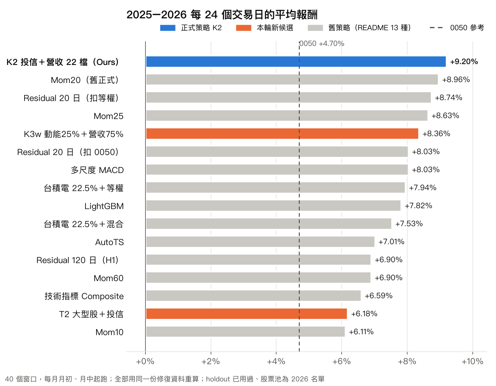
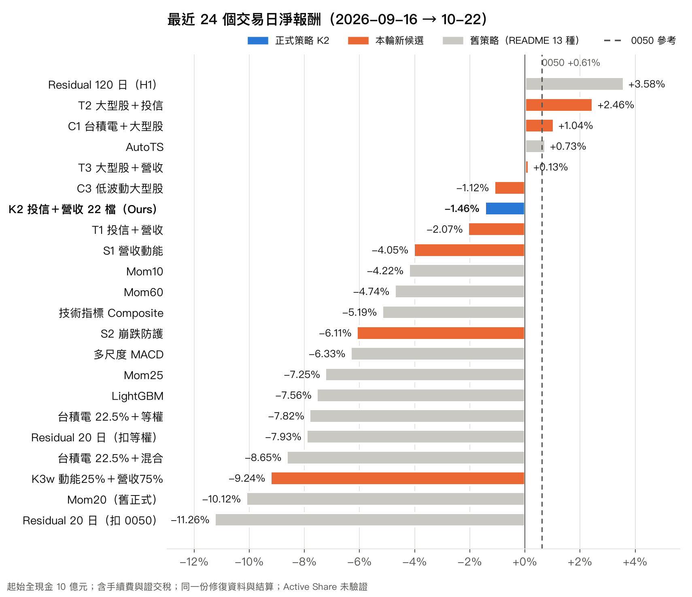
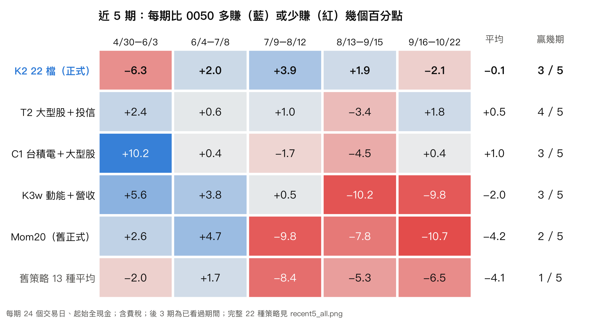

# 玉山 ETF 競賽：每日選股

150 檔挑 22 檔，跑 24 個交易日；目標是組內前 6 名（627 隊參賽）。

## 目前策略：K2＋排行榜切換

- K2：投信買超＋營收創新高
	- 前 10 檔各 8.5%，其餘 12 檔各約 0.83%
	- 新月營收公布後重篩
- 第 13 日起連續 2 天組內前 6 → 換成 T2 鎖住
	- T2：台積電 23.5%＋大型股投信買超
	- 分天換倉，換完不再換回
- 回滾設定：`production/strategy_mom20.json`、`production/strategy_k2_20.json`
- [策略細節](docs/strategy.md)

## 表現

| 期間 | K2 | 0050 | 備註 |
|---|---:|---:|---|
| 2025–2026 平均（40 窗口） | +9.20% | +4.70% | • 第一名<br>• 只比 Mom20 多 0.24pp |
| 最近 24 日（9/16–10/22） | −1.46% | +0.61% | • 比 Mom20 少虧 8.7pp |
| 近 5 期 | 贏 3 期 | — | • 平均 −0.11pp |

- 測過未採用
	- K3w：最近兩期各輸 0050 約 10pp
	- KT 混合：較穩，但大贏機率少一半
- [數據與檢核](research/results/benchmark_20261025/CODEX_REPORT.md)







## 每日提交

首日 10/27（10/23、10/26 休市），隊號 `TEAM_11076`。

1. T−1 19:00 後：後台下載 DataPack，放進 `production_runs/datapacks/`（不進 git）
2. 看排行榜組內名次（每天都填，切換要用前一天名次）
3. 19:30 到 T 日 08:55 之間執行：

```bash
./run_daily.sh <T> --datapack production_runs/datapacks/<DataPack>.json --rank <組內名次>
```

4. 看到 `READY_TO_SUBMIT` → 上傳 `production_runs/<T>/D-Plan_TEAM_11076_<T>.json` 並送出

- 程式自動抓：價格、法人買賣超、月營收、主動 ETF 前 10 大（MoneyDJ）
	- 你提供什麼、Agent 抓什麼、決策用什麼：[資料來源](docs/data_sources.md)
- 送出前自動檢查後台每日項目
	- 20–30 檔、150 檔標的池
	- 現金 0–25%、交割金額不足
	- 個股 ≤10%、台積電 ≤25%
	- Active Share 最低值 ≥30% 才放行
- 其他狀態：看 `production_runs/<T>/audit.md`
- [怎麼跑](docs/how_to_run.md)、[規則與操作](docs/rules_v43.md)、[比賽規則](docs/task.md)

## 其他

- [加權搜尋圖](research/results/k3_weights/figures/weights.png)、[大贏大輸比較](research/results/k3_composite/figures/tails.png)
- [近 5 期完整 22 種](research/results/benchmark_20261025/figures/recent5_all.png)
- [舊研究](legacy/README.md)
