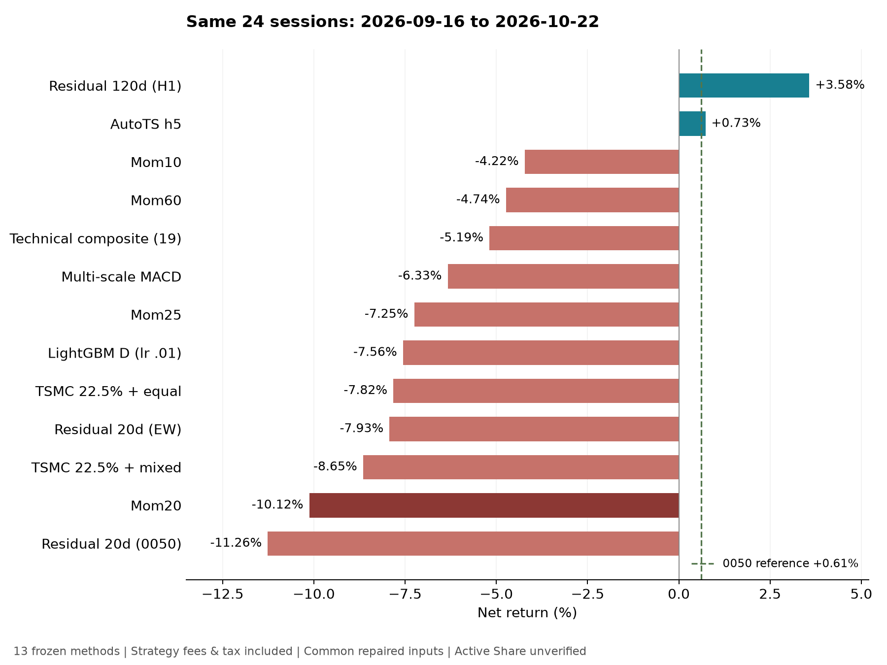

# 原README策略：最近24交易日重測

**此窗Residual 120日領先，AutoTS略高於0050；不替換正式候選。** 原表13版全測，2026-09-16–10-22、初始全現金10億元、僅讀D−1資料，末3日依各版既定凍結規則。

## 結果

| 策略 | 淨報酬 | 最大回撤 | 費稅／初始NAV | 對0050 |
|---|---:|---:|---:|---:|
| Residual 120日（H1） | +3.58% | 6.06% | 0.32% | +2.97 pp |
| AutoTS h5 | +0.73% | 5.60% | 1.62% | +0.12 pp |
| Mom10 | -4.22% | 11.48% | 1.89% | -4.83 pp |
| Mom60 | -4.74% | 9.63% | 0.58% | -5.35 pp |
| 技術指標Composite | -5.19% | 9.06% | 1.81% | -5.80 pp |
| 多尺度MACD | -6.33% | 11.12% | 1.57% | -6.94 pp |
| Mom25 | -7.25% | 12.81% | 1.18% | -7.86 pp |
| LightGBM D lr0.01 | -7.56% | 14.30% | 1.74% | -8.17 pp |
| 台積電22.5%＋等權 | -7.82% | 12.06% | 0.69% | -8.43 pp |
| Residual 20日（扣等權） | -7.93% | 12.37% | 1.09% | -8.54 pp |
| 台積電22.5%＋混合權重 | -8.65% | 13.19% | 1.35% | -9.26 pp |
| Mom20 | -10.12% | 13.79% | 1.02% | -10.74 pp |
| Residual 20日（扣0050） | -11.26% | 14.86% | 1.11% | -11.87 pp |

0050 **+0.6118%** 為未扣策略成本的close-to-close含權息參考，非競賽可交易投組。13組均0警告、0未成交；缺歷史ETF持股，Active Share全未驗證。



## 公平性與原版設定

清單依 `legacy/ml/momv2/main_figure.py:METHODS`、`legacy/ml/results/main_table.md`，非事後挑版。共用canonical下單／結算／費率、150檔池及修正資料；保留各版組合差異：台積電核心22.5%及原權重，其餘依原表等權／特徵。

| 方法 | 固定設定 |
|---|---|
| Mom20／25／10／60 | 各自原lookback；Top25／95%／keep35／10%換手門檻 |
| Residual20扣0050 | resid20／beta60 |
| Residual20扣等權 | resid20／beta60；leave-one-out市場 |
| Residual120 H1 | 原freeze：resid120／beta250 |
| Composite | 原19指標composite |
| MACD | 原8/24、16/48、32/96多尺度 |
| 台積電＋等權 | 原22.5%核心，其餘24檔 |
| 台積電＋混合 | 原0.85 shifted score＋0.15 inverse60d vol |
| AutoTS | 原autots_h5；原7候選／4 validation窗口選模程序 |
| LightGBM | 原lgbm_D_lr0.01；固定116樹／horizon10／每5日重訓 |

模型資料自2019年起。LGBM用2020–2024校準樹數，不在此窗early-stop；標籤須成熟至D−1。AutoTS沿用原選模、候選、seed、預算；修復後選ARIMA，原缺值資料選WindowRegression，屬原演算法的輸入反應。

## 本輪修復的資料問題

前次增量拼接漏算7/1對6/30報酬，149股加0050共150筆return=NaN，價格有效；導致LGBM首日60日波動特徵全缺，本輪才發現。

修復僅依6/30 close、7/1 close／split／dividend重算原公式，不改價格／參數／原快取。13組共用新snapshot；舊結果完整存各組 `original_panel_evidence/`。Mom20不變；Mom60、H1、Composite、MACD、AutoTS有變，表採修復後結果。

修復資料SHA256：`fe3f91fa6e96aad89fff6bd8de9b768d31ff7897ac7b37b16a4494fec13de15d`。邊界修復可由 `production_runs/preflight_20261026/strategy_retest/repair_boundary.py` 精確重建；總表內含全部來源雜湊與13份config。

## 驗證與解讀

13組×24日＝312筆，逐組獨立驗帳通過。主代理再依CSV核對股數、費稅、現金、NAV、末期股利，容差0.01元，全過；共同輸入SHA逐份一致。Mom20精確重現−10.1245967582%。每日最大資料／成熟標籤日期均存檔；6組非Mom/residual另經子代理交叉QA。

單一已見窗口的H1的+3.58%、AutoTS的+0.73%不證明優越；AutoTS僅高0050約0.12百分點。H1較長既有測試曾落後Mom20，故不改設定／正式候選。

10/23全151筆volume=0，非有效收盤，末日維持10/22。配股／現金權益未獨立對照官方結算；名目股數價格換算及2890六筆來源差異沿用前診斷，非官方認證。

## 證據與重現

[比較CSV](comparison.csv)、[全部數字與設定](comparison.json)。原始成交、持股、委託與逐日帳本保存在 `production_runs/preflight_20261026/strategy_retest/`。

```bash
.venv/bin/python production_runs/preflight_20261026/strategy_retest/repair_boundary.py
PYTHONHASHSEED=0 PYTHONPATH=. .venv/bin/python production_runs/preflight_20261026/strategy_retest/momentum/run.py
PYTHONHASHSEED=0 PYTHONPATH=. .venv/bin/python production_runs/preflight_20261026/strategy_retest/technical/run_retest.py
PYTHONHASHSEED=0 OPENBLAS_NUM_THREADS=1 .venv/bin/python production_runs/preflight_20261026/strategy_retest/models/run_models.py --strategy autots_h5 --full
PYTHONHASHSEED=0 OPENBLAS_NUM_THREADS=1 .venv/bin/python production_runs/preflight_20261026/strategy_retest/models/run_models.py --strategy lgbm_D_lr0.01 --full
PYTHONHASHSEED=0 PYTHONPATH=. .venv/bin/python production_runs/preflight_20261026/strategy_retest/collect.py
```
